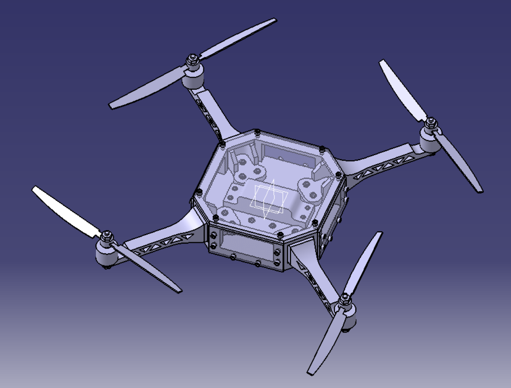
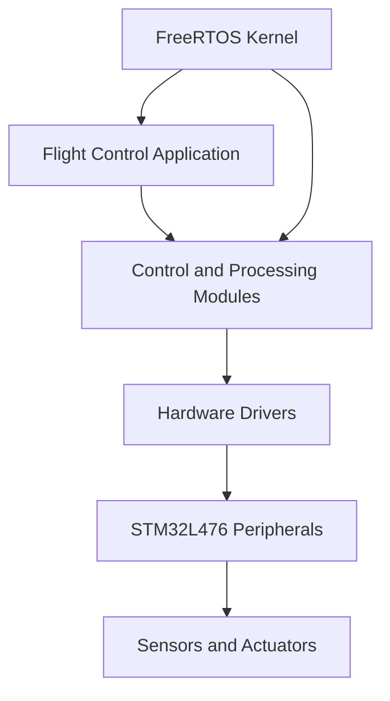

# STM32 Quadcopter Flight Control System

<p align="center">
  <strong>Embedded Flight Control · STM32L476 · C · CMake · FreeRTOS</strong>
</p>
<p align="center"></p>
<p align="center">
  
  
  
  
</p>

## Overview

This project focuses on the development of an embedded flight-control system for a quadcopter UAV, based on the **STM32L476 microcontroller**.

The objective is to develop and integrate the low-level software required for a multirotor flight controller, combining embedded programming, peripheral interfacing, real-time execution, and flight-control algorithms.

The project uses C for firmware development, CMake for build configuration, and FreeRTOS as the real-time operating system kernel.

The software is organized to support modular development, hardware integration, and the progressive implementation and validation of flight-control functions.

## Key Features

- **Embedded flight control:** Firmware development for an STM32-based quadcopter.
- **Real-time software:** FreeRTOS kernel integration.
- **Modular architecture:** Separation of application code, hardware drivers, and operating-system components.
- **Build system:** CMake-based project configuration.
- **ARM Cortex-M development:** Firmware targeting the STM32L476 microcontroller.
- **Hardware interfacing:** Integration of microcontroller peripherals through the STM32 driver ecosystem.
- **Extensible control architecture:** Foundation for sensor acquisition, attitude estimation, and closed-loop stabilization.

*The implementation status of individual flight-control functions should be confirmed against the source code and hardware tests.*

## System Architecture

The firmware is organized around three principal software layers.



### Application Layer

Contains the application logic responsible for coordinating the flight-control functions.

### Hardware Driver Layer

Provides the interfaces required to interact with the STM32 peripherals and connected hardware.

### Real-Time Operating System

FreeRTOS provides task-management and synchronization facilities for applications that require concurrent execution.

The final task structure, priorities, timing constraints, and synchronization mechanisms depend on the implemented firmware configuration.

## Hardware Platform

| Component | Description |
|---|---|
| Microcontroller | STM32L476 |
| Processor architecture | Arm Cortex-M4 |
| Firmware language | C |
| Build system | CMake |
| Real-time kernel | FreeRTOS Kernel V11.2.0 |
| Development environment | VS Code / CMake-compatible toolchain |
| Hardware development board | STM32L476-based board |

The exact sensor models, electronic speed controllers (ESCs), motors, communication interfaces, and power system should be documented once the final hardware configuration is confirmed.

## Repository Structure

```text
Quadcopter_drone/
├── Core/                       # Core application and MCU support files
├── Drivers/                    # Hardware drivers and supporting libraries
├── FreeRTOS-KernelV11.2.0/     # FreeRTOS kernel source
├── cmake/                      # CMake configuration files
├── build/Debug/                # Debug build output
├── CMakeLists.txt              # Main build configuration
├── CMakePresets.json            # Build presets
├── STM32L476RGTx_FLASH.ld      # Flash memory linker script
├── startup_stm32l476xx.s       # Startup assembly
└── README.md                    # Project documentation
```

## Development Environment

The following tools are suitable for working with this project:

- Visual Studio Code
- CMake
- Ninja or another compatible build generator
- Arm GNU Toolchain (`arm-none-eabi-gcc`)
- CMake Tools extension for VS Code
- STM32CubeProgrammer or a compatible debugging and flashing tool
- ST-Link debugger/programmer

Ensure the installed toolchain matches the configuration specified in the project.

## Build Instructions

### 1. Clone the repository

```bash
git clone https://github.com/itsaxelc/Quadcopter_drone.git
cd Quadcopter_drone
```

### 2. Configure the project

From the project root, configure a Debug build:

```bash
cmake --preset Debug
```

If the preset requires additional tools or environment variables, configure those according to `CMakePresets.json`.

### 3. Compile the firmware

```bash
cmake --build --preset Debug
```

The output location depends on the active CMake preset and generator.

If these preset names are not available in your local configuration, inspect `CMakePresets.json` and use the corresponding configure and build preset names.

## Flashing and Debugging

To deploy the firmware to the target board:

1. Connect a compatible ST-Link debugger/programmer to the board's SWD interface.
2. Verify the target voltage and MCU detection.
3. Build the firmware successfully.
4. Flash the generated firmware using the configured programming tool.
5. Start a debug session and verify initialization and peripheral operation.

The linker script `STM32L476RGTx_FLASH.ld` defines the target memory layout, while `startup_stm32l476xx.s` provides the startup code.

Successful compilation and flashing do not establish flight readiness.

## Flight-Control Development Roadmap

The following areas are relevant to the progressive development and validation of the flight controller.

- [ ] Verify MCU initialization and peripheral configuration.
- [ ] Validate sensor communication and measurement acquisition.
- [ ] Implement and validate attitude estimation.
- [ ] Develop and tune attitude-stabilization control loops.
- [ ] Implement motor command generation and ESC interfacing.
- [ ] Define and verify real-time task periods and priorities.
- [ ] Add sensor-fault handling and communication-loss failsafes.
- [ ] Measure control-loop execution time and timing jitter.
- [ ] Validate control logic through simulation and hardware-in-the-loop testing.
- [ ] Perform controlled ground tests before any flight tests.

These items represent a development checklist, not a claim that all functions are already implemented.

## Safety Considerations

A quadcopter flight controller directly influences motor commands and aircraft stability.

Before operating the system:

- Remove propellers during initial firmware and actuator tests.
- Verify sensor orientation, motor order, and motor rotation direction.
- Test emergency-stop and communication-loss behaviour.
- Check battery voltage, power distribution, and electrical connections.
- Validate control-loop timing and actuator limits.
- Perform initial powered tests in a controlled environment.

Do not attempt flight until the firmware, hardware integration, and failsafe mechanisms have been appropriately validated.

## Author

**Cédric Compaore**

Aeronautical Engineering and Space Technologies

Technical interests:
- Embedded Systems and Real-Time Software
- Avionics and Flight-Control Systems
- UAV Guidance, Navigation, and Control
- STM32 Firmware Development

GitHub: [@itsaxelc](https://github.com/itsaxelc)

Repository: [Quadcopter_drone](https://github.com/itsaxelc/Quadcopter_drone)

---

<p align="center">
  <i>Developing modular embedded software for reliable UAV flight-control systems.</i>
</p>
