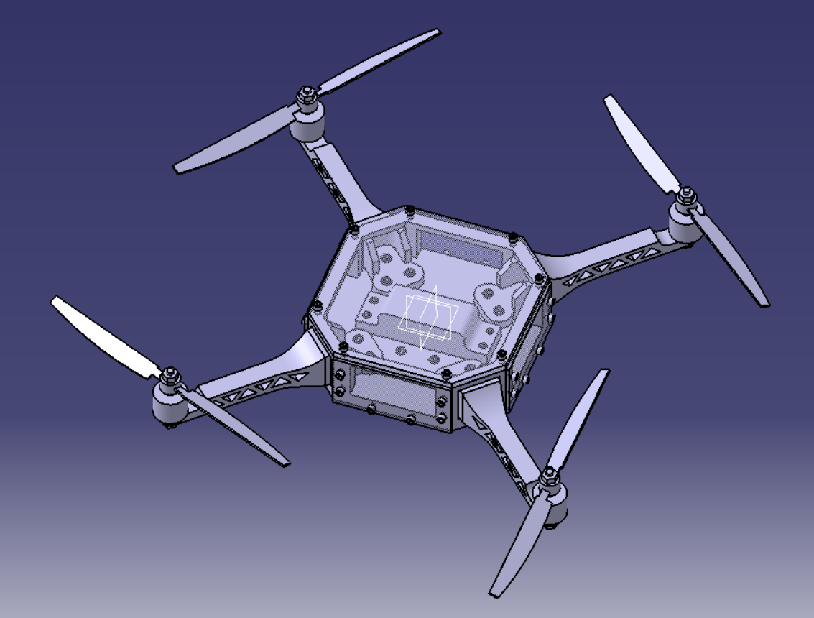

# STM32 Quadcopter Flight Control System

<p align="center">
  <strong>Embedded Flight Control · STM32L476 · C · CMake · FreeRTOS</strong>
</p>
<p align="center"></p>
<p align="center">
  
  
  
  
</p>

# Quadcopter Drone --- STM32 Bare-Metal Drivers and Flight Control

Embedded flight-control software for a quadcopter built around an STM32
microcontroller. The project combines low-level peripheral drivers, an
MPU9250 inertial sensor, and a real-time flight-control application.

> **Project status:** Hardware behavior and flight readiness must be
> validated on the target board. Do not arm motors until sensor
> initialization, calibration, motor outputs, failsafe behavior, and
> control-loop timing have been tested safely.

## Features

-   Register-level STM32 peripheral access for selected custom drivers.
-   A **single reusable I2C driver** for supported I2C peripherals,
    rather than separate `i2c1.c`, `i2c2.c`, and similar
    implementations.
-   Per-bus configuration through an `I2C_Handle`.
-   MPU9250 sensor driver for inertial measurements.
-   Real-time flight-control tasks and PID-based control.
-   PWM motor outputs and radio-control input capture.
-   CMake-based build workflow using an ARM embedded toolchain.

## Hardware and software

The exact peripheral instances, pin assignments, MCU target, and build
options are defined by the project source and configuration files. Check
those files before adapting the project to another board.

  -----------------------------------------------------------------------
  Component                           Role
  ----------------------------------- -----------------------------------
  STM32 MCU                           Runs the embedded application and
                                      flight-control logic

  MPU9250                             Gyroscope and accelerometer
                                      measurements; includes an AK8963
                                      magnetometer

  I2C                                 Communication with the sensor using
                                      a shared driver API

  PWM outputs                         Motor command generation

  Radio input                         Pilot command acquisition

  FreeRTOS / real-time tasks          Scheduling of application and
                                      control activities, where enabled
  -----------------------------------------------------------------------

## I2C driver architecture

The project uses one generic I2C driver instead of maintaining an
independent implementation for each I2C peripheral.

A typical application setup is:

``` c
static I2C_Handle hi2c2;

if (I2C_Init(&hi2c2,
             I2C_INSTANCE_2,
             I2C2_PINS_PB10_PB11) != I2C_OK)
{
    Error_Handler();
}
```

Sensor functions receive the configured handle, allowing the sensor
driver to use the selected bus without hard-coding its peripheral
registers:

``` c
MPU9250_Init(&hi2c2);
```

The exact function signatures and supported instance/pin combinations
are defined in `i2c.h`. Use only pin mappings supported by the target
MCU and package.

## MPU9250 integration

The MPU9250 driver provides access to inertial sensor data through the
generic I2C interface. The device also contains an AK8963 magnetometer,
whose operation depends on the MPU9250 auxiliary-I2C/bypass
configuration and the implementation in the sensor driver.

Before relying on magnetometer readings, verify that startup explicitly
configures the required access mode and initializes the AK8963. Also
check and handle the return value of sensor initialization; do not
assume the sensor is ready just because the I2C peripheral was
initialized.

## Build

The project uses CMake and an ARM embedded GCC toolchain. A typical
build flow, from the repository root, is:

``` bash
cmake -S . -B build -G Ninja
cmake --build build
```

These commands assume that CMake, Ninja, and the appropriate ARM
embedded toolchain are installed and that the repository's CMake
configuration supports this generator. Follow the project's actual
toolchain/configuration files if your setup differs.

## Repository layout

The source tree may evolve. The key files to locate are:

-   `main.c` --- application startup and peripheral initialization.
-   `i2c.h` / `i2c.c` --- generic I2C driver and public API.
-   `mpu9250.h` / `mpu9250.c` --- MPU9250 sensor driver.
-   The RTOS/task and flight-control source files --- scheduling, sensor
    processing, control logic, and motor commands.
-   `CMakeLists.txt` and toolchain configuration --- build targets and
    compiler settings.

## Safety and validation checklist

Before powering motors or attempting a flight:

1.  Confirm the MCU clock configuration and the I2C timing register
    value for the selected I2C kernel clock and target bus speed.
2.  Check the I2C bus with the sensor connected and verify that
    initialization and register reads succeed.
3.  Verify accelerometer and gyroscope axes, units, offsets, and
    calibration behavior.
4.  If using the magnetometer, verify AK8963 initialization, data-ready
    handling, and measurement validity.
5.  Test receiver-loss and sensor-failure behavior.
6.  Confirm motor order, rotation direction, PWM limits, and disarmed
    output behavior with propellers removed.
7.  Measure control-loop timing and check for missed deadlines before
    any flight test.

## Contributing

Keep hardware-specific register details inside the relevant peripheral
driver where practical. Application and sensor code should use the
public driver interfaces rather than duplicating register-level I2C
transactions.
